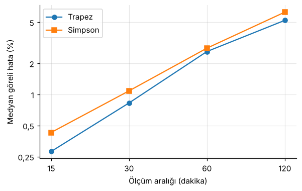
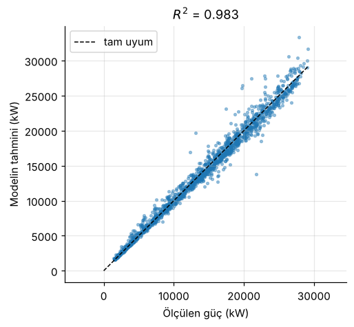
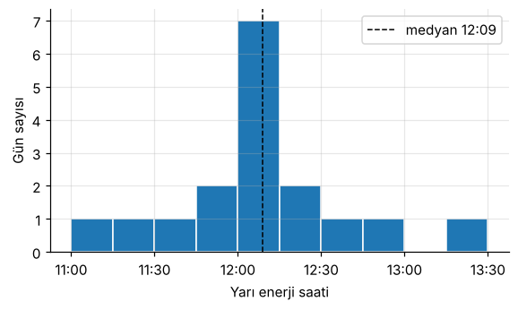

# Güneş Santrali Verisiyle Nümerik Analiz

Nümerik Analiz'in üç temel konusu (sayısal integrasyon, en küçük kareler, kök bulma) gerçek bir güneş santrali verisine uygulanıyor. Her yöntem NumPy ile sıfırdan yazıldı, önce sonucu bilinen basit bir örnekte test edildi, sonra SciPy/NumPy'nin hazır fonksiyonlarıyla aynı sonucu verdiği kontrol edildi.

**Veri:** [Kaggle – Solar Power Generation Data](https://www.kaggle.com/datasets/anikannal/solar-power-generation-data) (Ani Kannal). Hindistan'da bir güneş santrali (Plant 1), 22 inverter, 15 Mayıs – 17 Haziran 2020, 15 dakikada bir ölçüm.

## Defterler

### 1. Sayısal integrasyon – [`01_integrasyon.ipynb`](notebooks/01_integrasyon.ipynb)
Trapez, Simpson ve Romberg ile günlük enerji (kWh), inverterin kendi enerji sayacıyla karşılaştırıldı.

> 15 dakikalık veride trapez kuralı günlük enerjiyi %0,3 hatayla buluyor ve bu veride Simpson ile Romberg'den daha isabetli.



### 2. En küçük kareler ve Gauss eliminasyonu – [`02_en_kucuk_kareler.ipynb`](notebooks/02_en_kucuk_kareler.ipynb)
$P = a\,G + c\,G\,(T - 25)$ modeli, normal denklemler ve kısmi pivotlamalı Gauss eliminasyonuyla çözüldü.

> En küçük kareler ile bulunan sıcaklık katsayısı β ≈ 0,0046/°C, silikon panellerin bilinen değeriyle uyumlu.



### 3. Kök bulma – [`03_kok_bulma.ipynb`](notebooks/03_kok_bulma.ipynb)
Bisection, Newton ve secant ile günün enerjisinin yarısının üretildiği saat bulundu.

> Newton yöntemi, türev olarak ölçülen gücü kullanarak yarı enerji saatini 4–5 iterasyonda buluyor.



## Çalıştırma

1. Kaggle'dan `Plant_1_Generation_Data.csv` ve `Plant_1_Weather_Sensor_Data.csv` dosyalarını indirip `data/` klasörüne (ya da defterlerin yanına) koyun.
2. `pip install numpy pandas scipy matplotlib jupyter`
3. `notebooks/` klasöründeki defterleri açın.

```
gunes-numerik-analiz/
├── README.md
├── notebooks/
│   ├── 01_integrasyon.ipynb
│   ├── 02_en_kucuk_kareler.ipynb
│   └── 03_kok_bulma.ipynb
├── gorseller/   # README'deki grafikler
└── data/        # CSV'ler (repoya konmaz)
```
