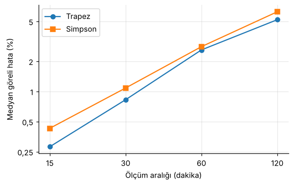
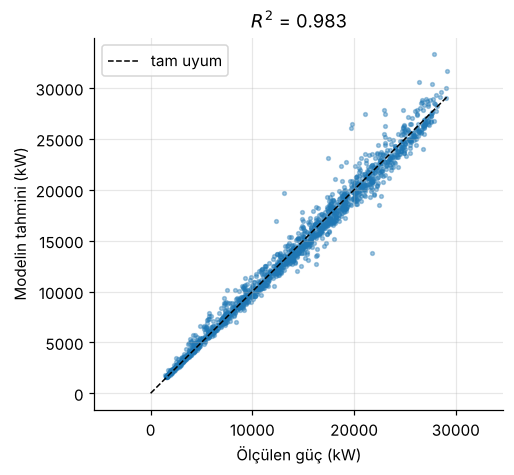
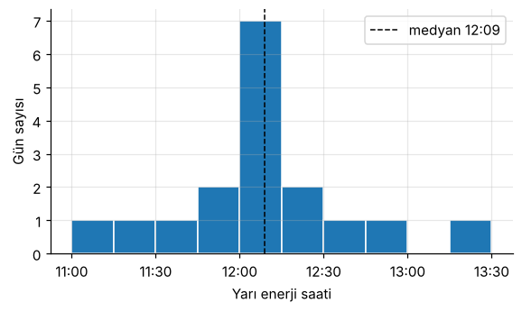

# Numerical Analysis of Solar Power Generation Data

This project applies three fundamental topics in numerical analysis — numerical integration, least-squares approximation, and root finding — to real-world solar power generation data.

The numerical methods are implemented using NumPy, tested on simple examples with known analytical solutions, and validated against built-in SciPy and NumPy functions.

**Dataset:** [Kaggle – Solar Power Generation Data](https://www.kaggle.com/datasets/anikannal/solar-power-generation-data) (Ani Kannal).

The dataset contains measurements from a solar power plant in India (Plant 1), covering 22 inverters from May 15 to June 17, 2020, at 15-minute intervals.

## Notebooks

### 1. Numerical Integration – [`01_integrasyon.ipynb`](notebooks/01_integrasyon.ipynb)

Daily energy production (kWh) is estimated using the trapezoidal rule, Simpson's rule, and Romberg integration. The results are compared with the energy readings recorded by the inverters.

> With 15-minute sampling intervals, the trapezoidal rule estimates daily energy production with approximately 0.3% error, outperforming Simpson's rule and Romberg integration on this dataset.



### 2. Least Squares and Gaussian Elimination – [`02_en_kucuk_kareler.ipynb`](notebooks/02_en_kucuk_kareler.ipynb)

The mathematical model

$$P = aG + cG(T - 25)$$

is fitted using the normal equations and Gaussian elimination with partial pivoting.

> The estimated temperature coefficient, β ≈ 0.0046/°C, is consistent with typical values for silicon solar panels.



### 3. Root Finding – [`03_kok_bulma.ipynb`](notebooks/03_kok_bulma.ipynb)

The bisection, Newton, and secant methods are used to determine the time at which half of the total daily energy has been generated.

> Newton's method, using measured power as the derivative of cumulative energy, converges to the half-energy time within 4–5 iterations.



## Getting Started

1. Download `Plant_1_Generation_Data.csv` and `Plant_1_Weather_Sensor_Data.csv` from Kaggle and place them in the `data/` directory or alongside the notebooks.
2. Install the required dependencies:

   ```bash
   pip install numpy pandas scipy matplotlib jupyter
   ```

3. Open and run the notebooks in the `notebooks/` directory.

## Repository Structure

```
gunes-numerik-analiz/
├── README.md
├── notebooks/
│   ├── 01_integrasyon.ipynb
│   ├── 02_en_kucuk_kareler.ipynb
│   └── 03_kok_bulma.ipynb
├── gorseller/   # Figures used in the README
└── data/        # CSV files (not included in the repository)
```
